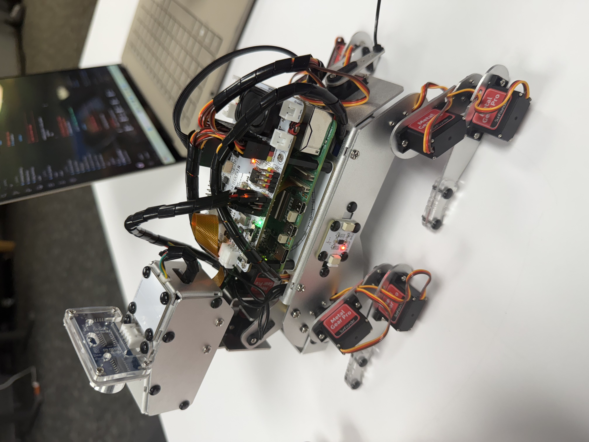

# pin_dog

A stability-focused Python control system for the **SunFounder PiDog** quadruped robot on Raspberry Pi 5. 



## Project Overview
Standard quadruped walking gaits often cause the PiDog robot to lose balance and tip over due to its high center of gravity, long un-damped legs, and fast head/body movements. **pin_dog** solves this mechanical instability through a **Low-Center-of-Gravity (Low-CoG)** stance design and a streamlined 3-step console workflow.

## Key Engineering Improvements
- **Low-CoG Crouch Stance (`crouch_stance`):** Lowers the leg joint angles before and after every step to keep the robot's body closer to the floor.
- **Controlled Slow Gait:** Limits walking and servo speeds (`walk_speed = 70`, `head_speed = 75`) and executes single-step increments (`step_count = 1`) to prevent lateral momentum tip-overs.
- **Pitch-Locked Head Stabilization:** Keeps the head slightly pitched downward (`pitch = -5`) with minimal yaw rotation (`±12°`) while moving.
- **Safe Grounded Audio Mode:** Transitions into a full resting posture (`rest_posture`) during music playback, featuring automatic fallback melody synthesis if no external `.wav` file is present.

## Demonstration Video
[Watch PiDog Demo Video](cd_1.mp4)


## Project Structure
```text
pin_dog/
├── pin_dog_app.py       # Main 3-step interactive console menu
├── hardware_driver.py   # Low-CoG kinematics, servo speeds, and RGB status driver
├── images/
│   └── pidog_demo.jpg   # Hardware demonstration photo
└── music/               # Optional folder for christmas.wav
```

## 3-Step Workflow
1. **Calibration & Low-Stance Warm-up:** Centers all leg and head servos into a balanced crouch posture, checks gentle yaw angles, and tests tail/LED response.
2. **Safe Low-Stance Movements:** Executes slow, single-step forward and backward locomotion while resetting the low center of gravity between steps.
3. **Christmas Music & Closing:** Lowers the robot safely to the floor, plays a holiday melody with synchronized RGB lighting and gentle nods, and speaks a closing thank-you message.

## How to Run
```bash
git clone https://github.com<your-username>/pin_dog.git
cd pin_dog
python3 pin_dog_app.py
```
